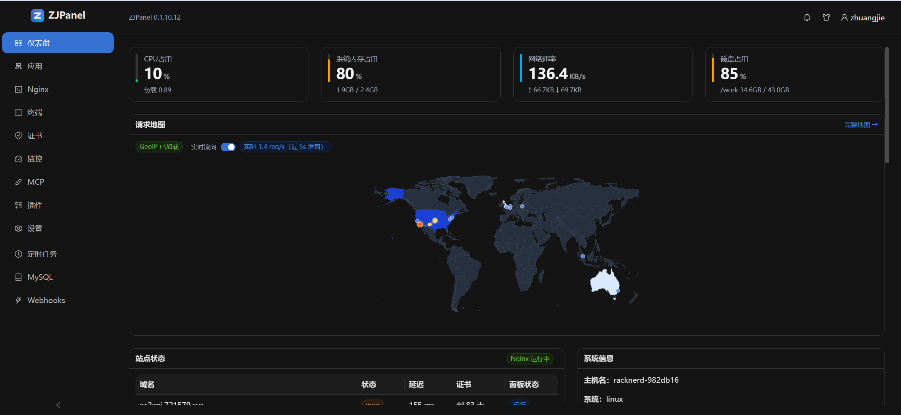
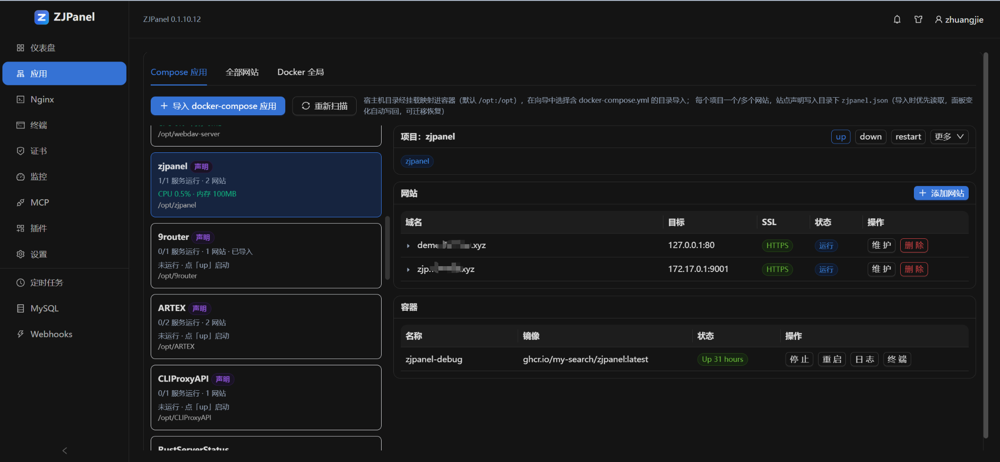

# ZJPanel

Go + Vue3 + TypeScript 服务器管理面板：**nginx 管理 + SSH 终端 + 主机 Agent + Docker 容器管理 + MCP + 证书自动化（certd 式管线）+ 插件化扩展**，单容器 Docker 部署。

## 界面预览

**仪表盘** —— CPU / 内存 / 网络 / 磁盘实时监控，请求地图（GeoIP 实时流向），站点状态总览



**应用** —— docker-compose 应用一键导入，网站 / SSL / 容器统一管理



## 功能一览

| 模块 | 说明 |
|---|---|
| **网站** | sites-available/enabled 模式（nginx-ui 同款），反代/静态站点，conf 生成 + 高级模式 raw 编辑；保存先 `nginx -t` 再 reload，失败自动回滚 |
| **维护页** | 全局模板 + 站点级覆盖；开启维护生成 `sites-enabled/<域名>_maintenance.conf`，请求代理到面板渲染器 |
| **默认页** | 404 / 50x / 首页 HTML 可视化编辑（Nginx → html 目录） |
| **Compose 导入** | 「应用 → 通过 docker-compose.yml 文件导入」文件夹选择向导（宿主机目录默认映射 `/opt:/opt`，容器内路径=宿主机路径），解析服务与发布端口导入为反代站点；站点声明写入目录下 `zjpanel.json`，面板变化自动写回，迁移时扫目录即恢复；「更多 → 删除」二次确认后删除关联网站并把项目从面板列表移除（容器与目录不动，`zjpanel.json` 保留，下次经导入向导「按声明恢复」即可重新管理）；「更多 → 标记停用/恢复正常」声明应用运维状态，停用应用的关联网站掉线不告警、不计入安全中心（探测仍按常规频率）；「一切安好？」二次确认后现场复检全部网站，把网站全 down 的应用置停用、有站点可用的应用置正常，并回显变更清单与方向 |
| **主机** | 一台机器一个对象：SSH 主机管理与终端合并；SSH 添加时可选「立即安装 Agent」，也可用面板生成的一行命令安装；Agent 出站反连（首帧 hello 认证 + 长期 token），15s 心跳上报负载/内存/磁盘/连接/SSH 会话/端口；详情页概览/防御/事件/终端/设置五个 Tab，Agent 版本落后可见并支持一键升级与卸载（ack 成功才删记录）；内置不可删除的「本机」承接容器内 Shell。防御页含 SSH/账号/持久化/暴露面/Webshell 五类只读基线检查（结果按主机落库，刷新/切换主机不丢；Agent 在线时每 6 小时自动检查），以及 nftables 主机层封禁（独立表 `inet zjpanel`，仅 IPv4、TTL 到期自动解封，不动系统已有规则）；终端 Tab 内嵌单会话终端，自带文件上传/下载/在线编辑与底部资源条；概览每 5 秒自动刷新，在线状态以 60 秒内心跳为准 |
| **Docker** | 容器/镜像/网络/卷管理，日志跟随、exec 终端、镜像拉取（WS 进度） |
| **证书** | certd 式管线：申请（HTTP-01/DNS-01，lego 多 DNS 提供商）→ 部署目标（本机 nginx / SSH 上传 / 本地脚本，可插件扩展）→ cron 自动续期；证书仓库 + 运行历史实时日志 |
| **请求地图** | access log 增量解析 + GeoLite2 城市级聚合（城市/国家/坐标），ECharts 世界地图 + 城市散点 + 流向线，WS 实时刷新 |
| **WAF（安全中心）** | 1s 级 access log 聚合（RPS/4xx/5xx/Top 源）+ 五类攻击判定（扫描/CC/爆破/站点失血/地区突变）+ 内核层 L4（连接数/SYN_RECV/带宽/accept 队列溢出，覆盖日志看不见的流量型攻击）；IP 与国家封禁（GeoIP 展开 CIDR 写入 nginx 原生 geo）、CC 限速、白名单、观察模式、封禁前 5 分钟 dry-run、规则自动封禁与严重事件通知；每秒落一份精简快照，面板被打到失联后可回放；本机回环/白名单来源与「停用应用」关联网站不计入判定。左侧菜单已由「安全」改名「WAF」 |
| **WAF 规则引擎** | 对 access log 的 URI/查询串/UA/Referer 做内容级检测（参考 SamWaf 的检测思路）：libinjection 词法判定 SQLi/XSS（多轮 URL 解码 + HTML 实体还原 + 第二信号压制误报）、命令执行、路径穿越、webshell、扫描器 UA、敏感路径、自定义正则（按路径/查询串/UA/Referer 分范围）；命中证据（解码后载荷片段）落盘 `data/waf/hits.jsonl`，按 IP 累犯阶梯封禁（默认 10/60/1440 分钟、24 小时清零），封禁批量下发 nginx（一次策略保存 + 一次 reload）；默认观察模式，可在「WAF 规则」页一键切拦截、逐条规则开关/切动作 |
| **监控** | CPU/内存/负载/网络实时（WS）+ 磁盘用量；历史采样 30 天 |
| **数据库** | 内置「数据库管理」插件：MySQL/MariaDB、PostgreSQL、SQLite、SQL Server、Oracle、Redis、MongoDB；连接管理（凭据加密）、库表/键/集合浏览、结构与 DDL、分页数据与行级编辑、SQL 与命令控制台、SQL 文件导入 |
| **MCP** | 面板唯一 `/mcp` 端点（Streamable HTTP + API Key），核心工具与**插件声明的工具聚合**统一对外 |
| **插件** | 内置/外部插件同一 SDK：菜单页、HTTP 路由、cron、事件订阅、MCP 工具、证书 DNS 提供商与部署目标注册；zip 上传安装，Yaegi 解释执行 |
| **更新** | 面板一键更新：容器部署走镜像式（compose 固定具体版本 tag + 启动自愈清理本地旧镜像，down/up 不回退），本地直跑走二进制式（`ZJPANEL_GH_MIRROR` 加速）；另有 `update.sh`（宿主机执行，同步容器镜像） |

## 快速部署（Linux 服务器）

```bash
mkdir -p /opt/zjpanel && cd /opt/zjpanel
# 下载（或复制仓库中的）deploy/docker-compose.yml 与 deploy/update.sh
cp docker-compose.yml update.sh ./
docker compose up -d
```

访问 `http://服务器IP:9000` → 首次进入创建管理员账号。

镜像来自 GitHub Container Registry：`ghcr.io/my-search/zjpanel`（由 GitHub Actions 在推送 `v*` tag 时自动构建 amd64/arm64 并发布 Release）。

**应用目录映射**：默认 `/opt:/opt`（宿主机 ↔ 容器，路径一致）。把 docker-compose 应用放到宿主机 `/opt` 下的任意目录，在面板「应用 → 通过 docker-compose.yml 文件导入」中即可选择导入；如需导入其他宿主机目录，在 `docker-compose.yml` 的 volumes 中追加一行 `- /srv/apps:/srv/apps` 后执行 `./update.sh` 重建。

目录结构（均在部署目录下，容器重建不丢）：

```
/opt/zjpanel/
├── docker-compose.yml / update.sh
├── data/          # SQLite、证书、插件、geoip、维护页模板
├── nginx/conf/    # nginx 配置（sites-available/enabled、nginx.conf）
├── nginx/logs/    # 访问/错误日志（请求地图数据源）
├── nginx/html/    # 默认页 + 静态站点目录
└── compose/       # docker-compose 项目目录（在此放你的 compose 项目）
```

> **host 网络说明**：容器使用 `network_mode: host`（Linux），nginx 直接监听宿主机 80/443，面板 9000；反向代理 compose 服务直接 `127.0.0.1:<发布端口>`。

## 升级

```bash
./update.sh            # 最新版（ghcr.io/my-search/zjpanel:latest）
./update.sh v1.2.3     # 指定版本
```

或在面板「设置 → 检查更新」中一键更新，按环境自动走两条路径：

- **容器部署**（检测到 docker.sock 且自身为 compose 容器）：把本目录 `docker-compose.yml` 的 image 固定为新版本 tag（留 `.bak`）→ 清理本地同名旧镜像（含 `:latest` 缓存）→ 重建容器时由 `compose up` 拉取新镜像。`docker compose down/up` 后不再回退；重建期间站点/面板短暂中断约数秒。此外面板**每次启动都会自愈**：即使你是通过二进制热更或 `update.sh` 升级上来的，新进程启动后也会自动把 compose 固定到当前版本并清理本地旧缓存，杜绝回退。compose 路径按 `ZJPANEL_DEPLOY_DIR` → compose 标签 → `/opt/zjpanel` 默认路径依次查找（默认 `/opt:/opt` 挂载下容器内可见）。
- **本地直跑**（非容器）：从 GitHub Release 下载当前平台二进制，校验后原地替换并以 exec 重启（PID 不变，站点不中断）；下载缓慢时可用 `ZJPANEL_GH_MIRROR`（如 `https://ghfast.top`）加速。

版本清单读取 GitHub Release（`api.github.com/repos/My-Search/ZJPanel/releases/latest`），推 `v*` tag 即发布新版本。

## 本地开发

```bash
# 后端（Windows 本机无 nginx/docker 时自动 dev 模式：写配置跳过 test/reload、Docker 显示不可用）
cd backend && go run ./cmd/zjpanel          # 端口 9000，数据在 ./dev-data

# 前端（dev 代理到 9000）
cd frontend && npm run dev                  # 端口 5173

# 构建产物（前端 dist 直接输出到 backend embed 目录）
cd frontend && npm run build
cd backend && go build -o zjpanel ./cmd/zjpanel
```

## MCP 接入

面板「MCP」页生成 API Key，客户端配置：

```json
{ "mcpServers": { "zjpanel": { "url": "http://面板IP:9000/mcp", "headers": { "X-Api-Key": "<key>" } } } }
```

内置工具：`panel_info / list_sites / create_proxy_site / toggle_site / nginx_test_reload / list_containers / container_action / container_recent_logs / get_metrics / list_cert_tasks / run_cert_task / compose_projects / compose_action`；插件可注册更多（命名 `<插件id>_<工具名>`）。

## 插件开发

外部插件 = `plugin.yaml + main.go`（可含 `dist/` 前端页），打成 zip 在「插件」页安装：

```yaml
# plugin.yaml
id: my-plugin
name: 我的插件
version: 0.1.0
menu:
  - title: 我的页面
    path: /
```

```go
// main.go（Yaegi 解释执行，可用全部标准库）
package main

import sdk "zjpanel/backend/sdk/plugin"

type P struct{ ctx sdk.Context }

func New() sdk.Plugin { return &P{} }

func (p *P) Meta() sdk.Meta {
	return sdk.Meta{ID: "my-plugin", Name: "我的插件", Version: "0.1.0",
		Menu: []sdk.Menu{{Title: "我的页面", Path: "/"}}}
}
func (p *P) OnInit(ctx sdk.Context) error {
	p.ctx = ctx
	ctx.RegisterMCPTool("hello", "打个招呼",
		map[string]any{"type": "object", "properties": map[string]any{
			"name": map[string]any{"type": "string"}}},
		func(args map[string]any) (string, error) { return "hello " + args["name"].(string), nil })
	ctx.SubscribeEvent("sitecheck.down", func(payload map[string]any) { /* 告警 */ })
	return nil
}
func (p *P) OnShutdown() {}
```

参考实现：`backend/plugins/notifywebhook/`（Webhook 通知：事件订阅 + MCP 工具 + 声明式设置）。

## 证书自动续期原理（certd 式）

每个任务按 cron 每日触发；`SkipWhenSucceed`：距到期 > 续期窗口（默认 20 天）直接跳过复用上次结果；临近到期自动重新申请并**并行**执行全部部署目标（写入本机 nginx 证书目录并 reload / SFTP 上传到远程主机并执行后置命令 / 自定义脚本），全过程按节点记录日志并在 UI 实时展示。HTTP-01 由 nginx 将 `/.well-known/acme-challenge` 转发到面板挑战端口（9100）；DNS-01 经 lego 支持 Cloudflare/阿里/腾讯/华为等，也可由插件注册新提供商。

## 目录结构

```
ZJPanel/
├── Dockerfile              # 三阶段：前端 → Go embed → alpine(nginx+docker cli)
├── deploy/
│   ├── docker-compose.yml  # 单容器部署（host 网络）
│   ├── update.sh           # 宿主机升级脚本
│   ├── entrypoint.sh       # 初始化 nginx → 启动面板
│   └── nginx-defaults/     # 默认 nginx.conf / 默认站点 / 默认页
├── backend/
│   ├── cmd/zjpanel/
│   ├── cmd/zjagent/        # 主机 Agent（单二进制：run/install/uninstall/upgrade/doctor）
│   ├── sdk/plugin/         # 插件 SDK（稳定接口）
│   ├── internal/           # boot/nginx/site/compose/cert/terminal/docker/metrics/logmap/security/waf/agent/mcp/plugin/update/http
│   └── plugins/notifywebhook/  # 内置示例插件
└── frontend/               # Vue3 + TS + Ant Design Vue
```

## 安全说明

- 面板为单管理员模型，登录会话 HttpOnly Cookie；登录限速（8 次/分钟，按真实 IP 与用户名双维度计数）
- 仅信任 `ZJPANEL_TRUSTED_PROXIES` 配置的反代 CIDR 解析 `X-Forwarded-For`（默认仅回环；直连伪造该头不影响限速与审计 IP）；面板直接暴露公网时建议设为 `none`
- SSH 密码/私钥、ACME 账户私钥、DNS 凭证均 AES-256-GCM 加密落库，v2 密文带 AAD 字段绑定（密文不可跨字段互换），启动时自动从旧格式无感升级；主密钥默认 `data/secret.key`，可用 `ZJPANEL_SECRET_KEY`（`openssl rand -hex 32`）改为环境注入实现密钥与数据分离
- 会话与登录时的密码哈希绑定：修改密码后其他设备全部下线，带外篡改用户表哈希所签发的会话在哈希还原后立即失效
- MCP API Key 仅存哈希；API Key 只能访问 `/mcp`，不能访问面板 UI 与 WS
- 全部变更操作记录审计日志（设置 → 审计）
